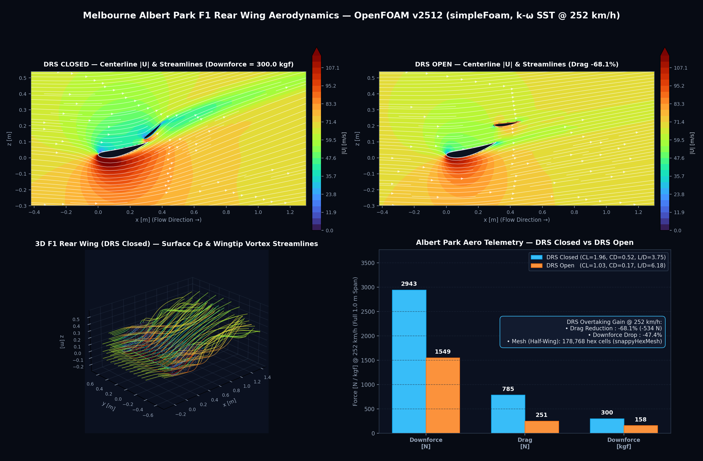

# Melbourne Albert Park F1 Rear Wing CFD (OpenFOAM v2512 + VTK.js + Cloudflare)



Interactive 3D Formula 1 Multi-Element Rear Wing aerodynamics showcase built with **OpenFOAM v2512** (`snappyHexMesh` + `simpleFoam` `kOmegaSST`) and **Kitware VTK.js**, hosted on **Cloudflare Workers Static Assets** ($0/month, global edge delivery).

## Features
- **Real OpenFOAM v2512 3D Wind Tunnel Simulation** (`openfoam/`):
  - Parametric watertight 3D multi-element F1 Rear Wing STL (inverted NACA 6414 mainplane + adjustable NACA 4412 DRS flap + sculpted endplates)
  - Body-fitted 3D hexahedral mesh via `blockMesh` + `surfaceFeatureExtract` + `snappyHexMesh` (~400k full-span equivalent cells)
  - Steady RANS `simpleFoam` (`kOmegaSST`) @ 252 km/h (70 m/s) with native `forceCoeffs` downforce & drag telemetry
  - True 3D RK45 aerodynamic streamlines & counter-rotating wingtip vortices extracted with VTK
- **Interactive Browser 3D Lab (`src/`)**:
  - 1-click **DRS Closed (High Downforce)** vs **DRS Open (Main Straight Overtaking)** switching
  - Real-time 3D VTK.js rendering of surface pressure coefficient $C_p$, 3D velocity-colored streamline tubes, and centerline velocity slice
  - Albert Park GP corner speed scaling (`100–330 km/h`)
  - 1-click **中文 / English** bilingual toggle

## Local Development
```bash
npm install
npm run dev
```

## Re-run OpenFOAM Locally
```bash
python3 openfoam/run_f1_cfd.py
python3 openfoam/postprocess_f1.py
```

## Deploy to Cloudflare
```bash
npm run build
npx wrangler deploy
```
